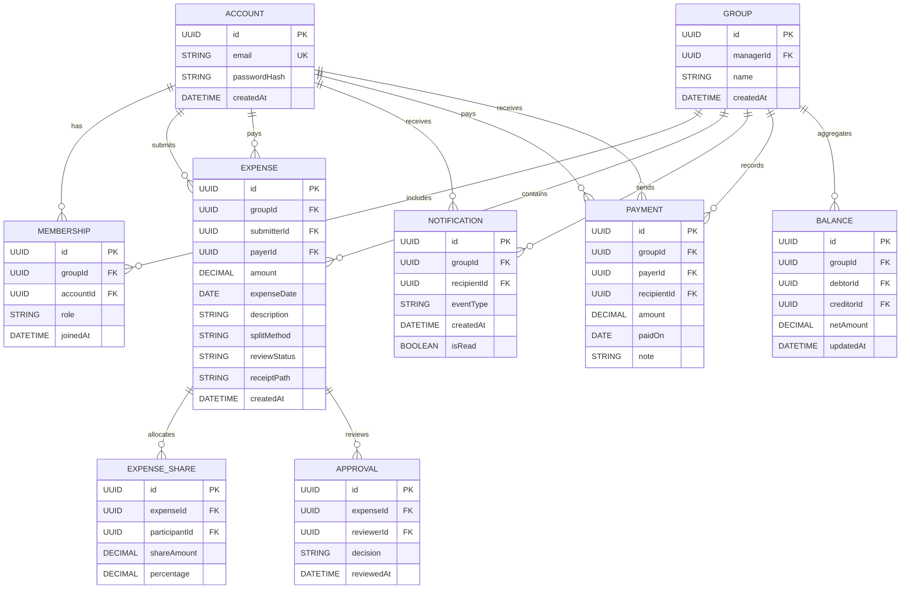
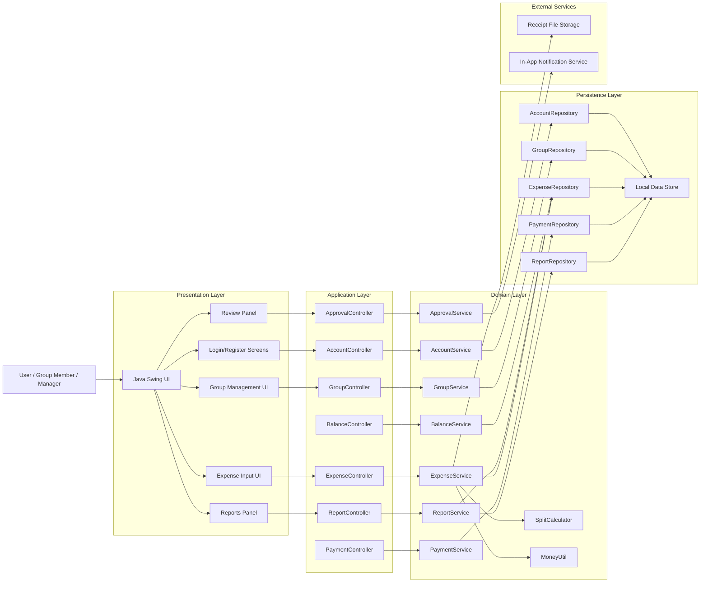
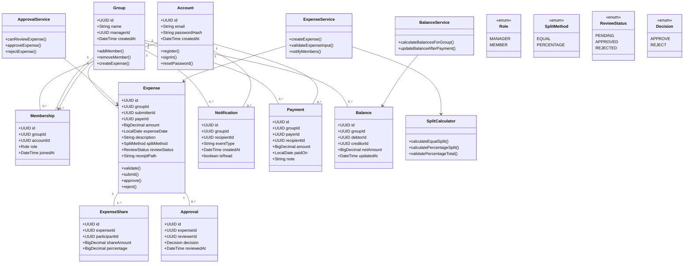

# SplitSmart Baseline Architecture

## 1. System Overview

SplitSmart is an expense-sharing application for individuals and groups such as roommates, friends, family, and coworkers. Its purpose is to make it easy for group members to create shared expenses, review them before they affect balances, track who owes whom, record payments, and review summaries over time.

The system is centered on a shared group context where users can:

- create personal accounts and sign in securely
- create and manage groups and memberships
- submit expenses with amount, date, description, payer, participants, split method, and optional receipt
- review pending expenses before they affect balances
- view and reconcile group balances
- record payments and reflect settlement in balances
- generate summaries and date-filtered reports

### Primary actors

1. Account holder
   - Registers, signs in, resets password, and can view personal expense and balance information.

2. Group member
   - Participates in a group, contributes to shared expenses, and views group activity relevant to that membership.

3. Group manager
   - Creates groups and manages membership.
   - May review expenses submitted by other members.

4. Expense submitter
   - Creates an expense record and provides the supporting data needed for approval.

5. Expense reviewer
   - A different group manager who approves or rejects a pending expense.

6. Payer
   - The group member who paid the expense and is credited in balance calculations.

### System boundaries and external integrations

The architecture described here reflects the baseline Java Swing desktop prototype specified by the project constitution. The major boundary is the desktop application itself, which interacts with:

- a local persistence layer for accounts, groups, expenses, payments, and reports
- optional local file storage for receipt images
- UI event flows driven by Swing interactions
- built-in application logic for validation, approval, balance calculation, and reporting

The specification also states that the full product must be primarily web-based with Android and iOS apps. This architecture does not replace that requirement; instead, it provides a stable domain model and layered design that can later be reused by a broader web/mobile product.

### Core business capabilities

- account registration and authentication
- group membership management
- expense creation with validation
- shared-split calculation
- approval workflow with eligible manager checks
- notifications for newly submitted expenses
- balance derivation from approved expenses and payments
- payment recording and settlement tracking
- reporting across date ranges and full history

## 2. Architecture Style

### Recommended style

The most appropriate baseline architecture for SplitSmart is a layered modular monolith.

This design fits the project because:

- the current scope is a desktop prototype with a bounded feature set
- the constitution explicitly requires Java 21, Maven, Java Swing, JUnit 5, and object-oriented separation between GUI and business logic
- the domain rules are financially sensitive and should remain centralized and testable
- the product is not yet large enough to justify independent services for each feature
- the architecture can evolve toward a web/mobile product without redesigning the core business rules

### Why not a microservice architecture?

A microservice approach would introduce unnecessary operational complexity for the current MVP. SplitSmart's requirements focus on a coherent shared-expense domain and a single managed business workflow, not on independent scaling domains or autonomous deployment units. The project is better served by a single deployable application with clear internal layers and strong domain boundaries.

### Architectural layers

1. Presentation layer
   - Java Swing screens and panels
   - user interactions and validation messages
   - no direct business calculations

2. Application layer
   - controllers/service coordinators
   - workflow orchestration for account, group, expense, approval, payment, and reporting actions
   - authorization checks and transaction coordination

3. Domain layer
   - core business services and rules
   - validation logic, approval decisions, split calculations, and balance derivation
   - financial calculations using BigDecimal

4. Persistence layer
   - repositories and query services
   - local data storage for the prototype
   - mapping between domain objects and persisted records

5. Infrastructure layer
   - notifications, file storage for receipts, configuration, and cross-cutting utilities
   - date processing, monetary utilities, and platform concerns

### Communication and data flow

Application flow is request-driven:

- Swing actions call application controllers
- controllers invoke domain services
- domain services validate business rules and compute financial outcomes
- repositories persist state and read data for reporting and reconciliation
- presentation components render aggregated results only

This keeps the UI thin and prevents GUI code from embedding expensive or sensitive domain logic.

### Scalability, maintainability, extensibility, and security

- Scalability: the modular monolith supports vertical scaling while preserving a single codebase; future product growth can be handled by splitting modules or exposing API services without rewriting core domain logic.
- Maintainability: explicit layers and package boundaries reduce cross-cutting complexity and help engineers work on specific concerns.
- Extensibility: new features like custom report types, additional split methods, or richer notification channels can be added within the domain without disturbing the UI.
- Security: authorization and validation are enforced in the application and domain layers, not in the UI, reducing risk of bypass.

### Trade-offs and alternatives

- Layered monolith vs microservices: chosen for current scope and reduced operational overhead.
- Thick client vs service-backed client: thick Swing app is best for the prototype; the domain layer remains portable for later web/mobile implementations.
- In-memory vs database persistence: persistent storage is required to meet group and report requirements; local persistence is the baseline choice for MVP.

## 3. Package Structure

The following directory structure reflects the layered modular monolith style and keeps responsibilities explicit.

```text
src/
├── main/
│   └── java/
│       └── com/
│           └── splitsmart/
│               ├── app/
│               │   ├── SplitSmartApplication.java
│               │   └── config/
│               │       ├── AppConfig.java
│               │       └── PersistenceConfig.java
│               │
│               ├── presentation/
│               │   ├── swing/
│               │   │   ├── LoginFrame.java
│               │   │   ├── RegisterFrame.java
│               │   │   ├── DashboardFrame.java
│               │   │   ├── GroupPanel.java
│               │   │   ├── ExpenseDialog.java
│               │   │   ├── ReviewPanel.java
│               │   │   ├── PaymentPanel.java
│               │   │   └── ReportPanel.java
│               │   ├── controllers/
│               │   │   ├── AccountController.java
│               │   │   ├── GroupController.java
│               │   │   ├── ExpenseController.java
│               │   │   ├── ApprovalController.java
│               │   │   ├── BalanceController.java
│               │   │   ├── PaymentController.java
│               │   │   └── ReportController.java
│               │   └── mappers/
│               │       └── UiModelMapper.java
│               │
│               ├── application/
│               │   ├── services/
│               │   │   ├── AccountService.java
│               │   │   ├── GroupService.java
│               │   │   ├── ExpenseService.java
│               │   │   ├── ApprovalService.java
│               │   │   ├── NotificationService.java
│               │   │   ├── BalanceService.java
│               │   │   ├── PaymentService.java
│               │   │   └── ReportService.java
│               │   └── validation/
│               │       ├── ExpenseValidator.java
│               │       ├── SplitValidator.java
│               │       └── PaymentValidator.java
│               │
│               ├── domain/
│               │   ├── model/
│               │   │   ├── Account.java
│               │   │   ├── Group.java
│               │   │   ├── Membership.java
│               │   │   ├── Expense.java
│               │   │   ├── ExpenseShare.java
│               │   │   ├── Approval.java
│               │   │   ├── Notification.java
│               │   │   ├── Payment.java
│               │   │   ├── Balance.java
│               │   │   └── Report.java
│               │   ├── enums/
│               │   │   ├── ReviewStatus.java
│               │   │   ├── SplitMethod.java
│               │   │   └── Role.java
│               │   ├── valueobjects/
│               │   │   ├── Money.java
│               │   │   └── Percentage.java
│               │   ├── rules/
│               │   │   ├── ApprovalRules.java
│               │   │   ├── SplitRules.java
│               │   │   └── BalanceRules.java
│               │   └── services/
│               │       ├── SplitCalculator.java
│               │       └── MoneyUtil.java
│               │
│               ├── persistence/
│               │   ├── repositories/
│               │   │   ├── AccountRepository.java
│               │   │   ├── GroupRepository.java
│               │   │   ├── MembershipRepository.java
│               │   │   ├── ExpenseRepository.java
│               │   │   ├── NotificationRepository.java
│               │   │   ├── PaymentRepository.java
│               │   │   └── ReportRepository.java
│               │   ├── jdbc/
│               │   │   └── JdbcDataSource.java
│               │   └── entities/
│               │       ├── AccountEntity.java
│               │       ├── GroupEntity.java
│               │       ├── ExpenseEntity.java
│               │       └── PaymentEntity.java
│               │
│               ├── infrastructure/
│               │   ├── storage/
│               │   │   └── ReceiptStorage.java
│               │   ├── notifications/
│               │   │   └── InAppNotificationPublisher.java
│               │   ├── clock/
│               │   │   └── SystemClock.java
│               │   └── security/
│               │       ├── PasswordHasher.java
│               │       └── AuthorizationService.java
│               │
│               └── shared/
│                   ├── constants/
│                   │   └── DomainConstants.java
│                   ├── exceptions/
│                   │   ├── ValidationException.java
│                   │   ├── AuthorizationException.java
│                   │   └── BusinessRuleException.java
│                   └── util/
│                       └── DateRange.java
│
├── test/
│   └── java/
│       └── com/
│           └── splitsmart/
│               ├── application/
│               │   └── services/
│               │       └── BalanceServiceTest.java
│               ├── domain/
│               │   └── rules/
│               │       └── SplitRulesTest.java
│               └── persistence/
│                   └── repositories/
│                       └── ExpenseRepositoryTest.java
└── resources/
    └── application.properties
```

### Package responsibilities and separation of concerns

- `presentation` contains only UI and interaction logic; it does not calculate money or enforce approval rules.
- `application` contains workflow orchestration and validation that crosses business boundaries.
- `domain` contains core financial logic, business rules, and entities; it is the most important package architecturally.
- `persistence` isolates database access and entity mapping from domain logic.
- `infrastructure` holds cross-cutting services such as storage, authorization support, notification delivery, and time utilities.

### Dependency and interaction rules

- presentation depends on application controllers
- application depends on domain services and rules
- domain does not depend on UI classes
- persistence depends on domain model contracts or mapper interfaces, not the other way around
- infrastructure is accessed through interfaces to avoid hard coupling to concrete implementations

### Circular dependency prevention

- no package should import a higher-level package in a way that creates cycles
- domain logic should not import Swing code or persistence classes directly
- repositories should be accessed through interfaces and not depend on UI code
- controllers should orchestrate, not own domain state

## 4. Data Model

The baseline data model is designed to satisfy the requirements for accounts, groups, expenses, approvals, notifications, payments, and reports while remaining testable and precise for financial calculations.

### Core entities

1. Account
   - id: UUID
   - email: String
   - passwordHash: String
   - createdAt: DateTime

2. Group
   - id: UUID
   - name: String
   - managerId: UUID
   - createdAt: DateTime

3. Membership
   - id: UUID
   - groupId: UUID
   - accountId: UUID
   - role: enum {MANAGER, MEMBER}
   - joinedAt: DateTime

4. Expense
   - id: UUID
   - groupId: UUID
   - submitterId: UUID
   - payerId: UUID
   - amount: BigDecimal
   - expenseDate: LocalDate
   - description: String
   - splitMethod: enum {EQUAL, PERCENTAGE}
   - reviewStatus: enum {PENDING, APPROVED, REJECTED}
   - receiptPath: String (nullable)
   - createdAt: DateTime

5. ExpenseShare
   - id: UUID
   - expenseId: UUID
   - participantId: UUID
   - shareAmount: BigDecimal
   - percentage: BigDecimal (nullable)

6. Approval
   - id: UUID
   - expenseId: UUID
   - reviewerId: UUID
   - decision: enum {APPROVE, REJECT}
   - reviewedAt: DateTime

7. Notification
   - id: UUID
   - groupId: UUID
   - recipientId: UUID
   - eventType: String
   - createdAt: DateTime
   - isRead: boolean

8. Payment
   - id: UUID
   - groupId: UUID
   - payerId: UUID
   - recipientId: UUID
   - amount: BigDecimal
   - paidOn: LocalDate
   - note: String (nullable)

9. Balance
   - id: UUID
   - groupId: UUID
   - debtorId: UUID
   - creditorId: UUID
   - netAmount: BigDecimal
   - updatedAt: DateTime

10. Report
   - id: UUID
   - groupId: UUID
   - startDate: LocalDate (nullable)
   - endDate: LocalDate (nullable)
   - generatedAt: DateTime
   - summaryJson: String

### Relationships and cardinality

- Account to Group: many-to-many through Membership
- Group to Expense: one-to-many
- Expense to ExpenseShare: one-to-many
- Expense to Approval: one-to-many (a single approval decision per review; potentially multiple review events if needed)
- Group to Notification: one-to-many
- Account to Notification: one-to-many as recipient
- Group to Payment: one-to-many
- Group to Balance: one-to-many

### Business constraints and validation rules

- Account email must be unique.
- A user must be able to reset a forgotten password.
- Group manager must be an authorized member of the group.
- Expense amount must be positive.
- Expense payer must be a valid group member.
- Participants must all belong to the group.
- No pending or rejected expense may affect balances.
- Approval can only be performed by a group manager other than the submitter.
- Percentage split must total exactly 100%.
- Equal splits and percentage splits must reconcile exactly to the expense total using BigDecimal.
- A payment cannot be recorded for a balance that does not exist unless the system allows settlement entry as a new record.
- A rejected or pending expense remains historical but never changes balances.

### Data integrity considerations

- Use BigDecimal for all monetary values to avoid binary floating-point errors.
- Keep approval logic separate from balance calculation to prevent unreviewed expenses from altering totals.
- Ensure all balance computations are derived from approved expenses and payment records rather than from ad hoc UI state.
- Store the optional receipt path in a nullable field instead of making file content mandatory.
- Maintain historical records for removed members without deleting prior expenses, approvals, or payments.

### Indexes and uniqueness constraints

Recommended indexes and constraints:

- `Account.email` unique
- `Membership(group_id, account_id)` unique
- `Expense(group_id, review_status, expense_date)` index
- `Payment(group_id, paid_on)` index
- `Balance(group_id, debtor_id, creditor_id)` unique
- `Notification(recipient_id, is_read, created_at)` index

### ERD (Mermaid)



## 5. UML Component Diagram

The component model shows the boundary between the Swing interaction layer and the domain services responsible for validation, approval, balance calculations, and persistence.



### Diagram explanation

The UI layer is intentionally thin and delegates all operational behavior to controllers and services. Domain services implement the actual business logic, while repositories handle persistence concerns. Notifications and receipt storage are treated as external capabilities to keep the core domain independent from UI and file system details.

## 6. UML Class Diagram

The class model below focuses on the core domain objects, their relationships, and the business rules described in the specification.



### Class diagram explanation

The domain model centers on `Group`, `Expense`, and `Balance`. `Expense` is the primary business record that captures approval and split rules, while `ExpenseShare` holds per-participant allocations. The financial outcome is derived by services that calculate balances from approved expenses and recorded payments, keeping the domain logic separate from Swing UI classes.

## 7. Technology Stack

### Frontend

- Java Swing for the desktop MVP, matching the project's Java 21 + Swing prototype requirement.
- Future web and mobile interfaces should be designed to consume the same domain services and validation logic.

### Backend

- Java 21
- Maven for build and dependency management
- object-oriented domain model with layered services and repository interfaces

### Database and persistence

- local relational database for the MVP, such as SQLite or another lightweight relational engine suitable for a desktop prototype
- repository abstraction to keep persistence independent from the domain
- future product may use a server-backed relational database with web APIs

### Authentication and authorization

- password hashing and secure login flow for account holders
- authorization checks in the application and domain layers to enforce:
  - account privacy
  - group membership restrictions
  - manager-only approval rules

### External services and integrations

- local receipt storage for optional images
- in-app notification service for expense creation alerts
- future external notification channels can be introduced without altering the domain model, if product requirements later clarify them

### Development and testing tools

- Maven for builds and dependency management
- JUnit 5 for automated tests
- PlantUML for architecture and design diagrams
- BigDecimal-based monetary testing for financial correctness

## 8. Quality Attributes and Architectural Considerations

### Scalability

The modular monolith allows the application to scale by component or by deployment phase without rewriting the domain. Shared expense logic is centralized and can later be exposed through APIs to a web or mobile frontend. Group and report queries are manageable in a relational store for the prototype unless the user base becomes large enough to justify distribution.

### Performance

- domain calculations remain in-process and simple to optimize
- queries should be indexed by group, date, and member identifiers
- reporting should aggregate over a known date range using a repository query rather than loading all records into memory
- known-expense and payment calculations should be derived rather than duplicated across the UI

### Security and privacy

- each account's personal information is restricted to the account owner
- group data is visible only to members and managers of that group
- approval rules are enforced before an expense affects balances
- password hashing and centralized authorization checks protect user and financial data

### Reliability and availability

- business rules are centralized in domain services so they are consistent across presentation methods
- data writes for approval and payment flows should be transactionally guarded to avoid inconsistent balances
- the application should validate financial data before persisting it

### Maintainability

- layers and package boundaries reduce confusion between view logic and business rules
- services and repositories are explicit and isolated
- a single domain model keeps financial and approval rules consistent across features

### Testability

- domain services can be exercised in JUnit 5 without launching Swing
- balance and split calculation rules are tested independently from UI components
- validation behavior and approval decisions can be implemented as deterministic unit tests

### Extensibility

- new split methods can be added as domain rules without rewriting the UI
- future web services or mobile clients can reuse the domain services
- notifications can grow from in-app messages to email or push without changing the account or expense core model

## 9. Architectural Assumptions and Risks

### Assumptions

- The MVP is a desktop prototype and does not replace the full web/mobile product requirement.
- One manager review is the approved approval model for the MVP.
- The application uses a single configured currency with two fractional digits unless product decision clarifies otherwise.
- The system stores receipt images locally or on a simple file path, pending explicit product storage requirements.
- The prototype does not include advanced reporting export or multi-channel notification features.

### Technical risks

- incorrect monetary behavior if BigDecimal is not consistently used across the domain
- hidden business-rule drift if validation is duplicated in the UI instead of the domain layer
- inconsistent balance updates when approval and payment records are not transactionally managed
- database growth if reports are implemented by repeated full-table scans rather than filtered queries

### Potential bottlenecks

- group-wide balance recalculation for large numbers of expenses and payments
- date-range report aggregation over a large historical dataset
- receipt file I/O if stored in a slow or unbounded location

### Architectural limitations

- the layered monolith does not provide independent horizontal scaling for each feature
- the design is intentionally conservative and optimized for the MVP rather than a full large-scale product
- the current model does not yet specify multi-tenant or web API boundaries beyond the local desktop scope

### Open questions requiring stakeholder clarification

- Should the full product support multiple approval levels beyond the single eligible manager review?
- Are email or push notifications required beyond in-app notifications?
- Which currencies and rounding rules are required across the product?
- Are partial payments allowed, and how should overpayments be handled?
- What are the required report filters and export formats?
- What is the account-deletion policy?

## 10. Requirements Traceability

| Requirement ID | Requirement summary | Responsible component/module | Architectural decision | Document section |
|---|---|---|---|---|
| FR-001 | Account registration, sign-in, password reset, personal access | `AccountService`, `AccountController`, `AccountRepository` | Layered validation and account ownership enforcement | 1, 2, 3, 4, 8 |
| FR-002 | Group creation and membership management | `GroupService`, `GroupController`, `MembershipRepository` | Explicit group membership model and authorization checks | 1, 3, 4, 8 |
| FR-003 | Expense creation with amount, date, description, payer, participants, receipt | `ExpenseService`, `ExpenseController`, `ExpenseRepository` | Domain-level validation and repository persistence | 1, 3, 4, 5, 6 |
| FR-004 | Equal and percentage split support with valid percentages | `SplitCalculator`, `ExpenseValidator`, `ExpenseService` | Domain rules for split calculations and total validation | 3, 4, 6, 8 |
| FR-005 | Review workflow and approval rules | `ApprovalService`, `ApprovalController`, `ExpenseRepository` | Single-review manager rule enforced in domain logic | 1, 3, 4, 6, 8 |
| FR-006 | Expense notifications to group members | `NotificationService`, `ExpenseService`, `NotificationRepository` | Event-based notification created on expense submission | 1, 3, 5, 8 |
| FR-007 | Balance tracking by member and pair | `BalanceService`, `BalanceController`, `Balance` model | Derived balances from approved expenses and payments | 1, 3, 4, 6, 8 |
| FR-008 | Payment recording and settlement | `PaymentService`, `PaymentController`, `PaymentRepository` | Payment workflow integrated with balance recalculation | 1, 3, 4, 6, 8 |
| FR-009 | Expense, balance, and payment reporting | `ReportService`, `ReportController`, `ReportRepository` | Repository-backed report generation with date range support | 1, 3, 5, 8 |
| NFR-001 | Web-first, Android and iOS product requirement | architecture layering and future API boundaries | Desktop prototype is separated from full product scope | 1, 2, 7 |
| NFR-002 | Restrict account and group information to authorized users | `AuthorizationService`, application/domain services | Centralized authorization and permission checks | 2, 8 |
| NFR-003 | Exact monetary arithmetic and reconciled shares | `MoneyUtil`, `BigDecimal`, `SplitCalculator` | Monetary precision policy and validation | 2, 4, 8 |

## Final notes

This architecture is intentionally conservative. It satisfies the documented requirements for the Java Swing prototype while preserving a clean domain model that can later support the broader product vision of a web-first solution with Android and iOS clients. The design makes the core financial and approval behavior explicit, testable, and reusable rather than dependent on the desktop UI.
